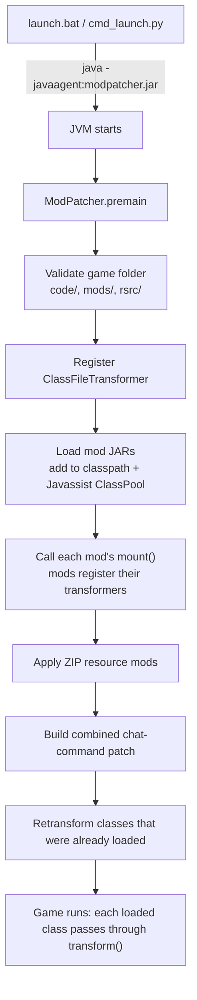

# ProjectX ModLoader

A runtime mod loader for the Java game **Spiral Knights**. It works as a **Java agent**: it hooks into the JVM's class loading and rewrites the game's compiled (and obfuscated) bytecode with [Javassist](https://www.javassist.org/) as each class loads. Mods are separate `.jar` plugins that tell the loader which game classes they want to patch and how.

> **Status:** No longer working. Spiral Knights updates re-obfuscate class and method names (`com.threerings.util.G`, method `OY`, ...), so the hardcoded targets broke. This repo documents how the system worked.
>
> Originally developed in 2025. Cleaned up for public release in October 2026: game binaries removed, some mods left out, small loader fixes.

## How it works



### 1. Java agent entry point
The loader jar's manifest declares `Premain-Class` and `Can-Retransform-Classes`. The launcher starts the game with `-javaagent:modpatcher.jar`, so `ModPatcher.premain(String, Instrumentation)` runs **before the game's `main`** and gets an `Instrumentation` handle to the JVM.

### 2. Bytecode transformation
`ModPatcher` implements `ClassFileTransformer`. Every class the JVM loads passes through `transform()` as raw bytes. If a registered mod says `shouldTransform(className)`, the bytes go to that mod. The mod parses them into a Javassist `CtClass`, edits methods or fields (`insertBefore`, `setBody`, new fields, even whole new classes), and returns the new bytecode.

Some target classes are already loaded by the time the agent finishes setting up. For those, the loader calls `Instrumentation.retransformClasses(...)` so they get patched too.

### 3. Plugin system
Each mod is a normal jar whose manifest points at a class with a static `mount(String)` method. The loader:
1. adds every mod jar (and the game's own jars) to the system class loader **and** the Javassist `ClassPool`, so patch code can reference game classes;
2. loads the mod's main class and calls `mount()` via reflection;
3. the mod calls `ModPatcher.registerTransformer(name, transformer)`.

Errors in one mod are caught and logged, so a broken mod doesn't take down the game.

### 4. Several mods patching the same method
Several mods add chat commands (e.g. `/loler`), and they all need to patch the **same** obfuscated chat-handler method. If each mod patched it separately, they would overwrite each other. Instead, mods register their snippet with `ChatDirectorManager`. After all mods are mounted, it merges every snippet into **one** transformation and injects it once with `insertBefore`. Mods can also ask it to add fields to that class.

### 5. Resource (ZIP) mods
`.zip` files in `mods/` are unpacked over the game's resource folder (textures, configs). The loader:
- skips files that haven't changed (size, timestamp, then **MD5** comparison);
- resolves every path canonically and **rejects entries that would land outside the game directory**, which protects against path traversal ("zip slip") from a malicious archive.

## Reverse engineering
The game client is obfuscated, so classes and methods have names like `a`, `Q`, `OY`. To find the hook points I decompiled the client, followed call chains from recognisable strings and UI behaviour, and checked method signatures against what the patch needed. Each mod checks that its target still exists and logs `"Game update?"` if it's gone, instead of crashing.

## Included mods

| Mod | What it does | Technique |
|---|---|---|
| **ShowPing** | Shows network latency on the minimap HUD | Patches HUD rendering |
| **PocketShop** | `/loler` chat command opens the auction house from anywhere | Chat-command injection, calls game UI code |
| **Pandora** | Preview shop items on your character | Generates new classes at runtime, patches 4 classes |
| **AutoAdvance** | Skips the end-of-level screen | Patches already-loaded classes (retransformation) |
| **MachineIdentifier** | bypasses machineIdentifier generation that is based off users hardware and instead uses choosen string as a seed | Method body replacement (`setBody`) |
| **RevealMap** | Removes minimap fog of war: patches tile-visibility `c(Coord)` to always return `1.0`, dungeon override defers to it | Method body replacement (`setBody`) |

## Project layout
```
Modpatcher/     the loader / Java agent (ModPatcher, ChatDirectorManager, ZipMod)
<ModName>/      one Maven module per mod
cmd_launch.py   launches the game's JVM directly with the right classpath and options
launch.bat      Windows shortcut: runs cmd_launch.py with -javaagent
pom.xml         Maven parent (Java 8, Javassist 3.29)
```

## Building and running
```bash
mvn package
# copy Modpatcher/target/modpatcher-shaded.jar into the Spiral Knights folder as modpatcher.jar
# copy mod jars into <game>/mods/
python cmd_launch.py --extra-args="-javaagent:modpatcher.jar"
```
Needs your own Spiral Knights install. **This repository contains no game code or assets.**

## What I'd do differently
- Look up obfuscated targets by **signature or bytecode pattern** instead of hardcoded names, so game updates don't break every mod.
- Let mods declare the classes they target, so the retransform list isn't hardcoded in the loader.
- Add a headless test harness that runs transformers against sample class files.
